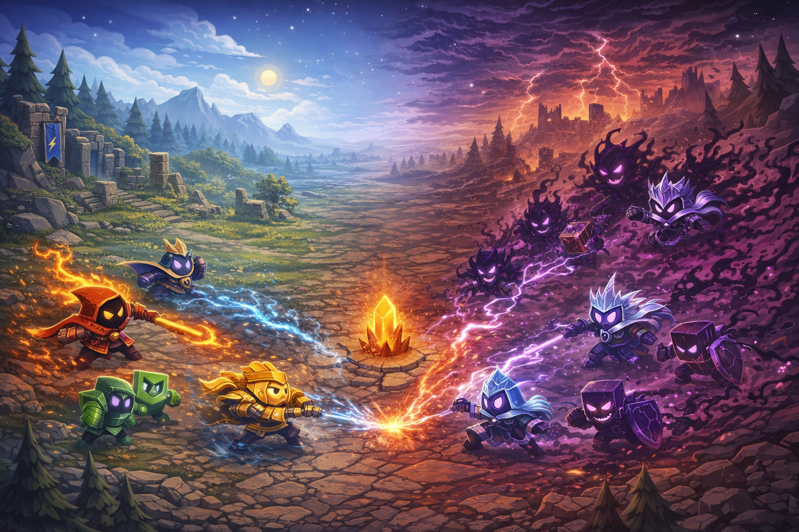

# Shape Strikers ⚔️

A tactical lane-based auto-battler built with **vanilla HTML, CSS, and JavaScript** — no game engine required.

🎮 **[Play Now](https://bytesower.github.io/ShapeStrikers-no-phaser-/)**



---

## About

Shape Strikers is a rogue-like auto-battler where you buy, place, and upgrade shape-drawn units to fight through waves of enemies. Strategy comes from **element synergies**, **unit positioning**, and **economy management**.

### Features

- **45 unique units** across 4 tiers and 8 elements (40 playable + 5 bosses)
- **Lane-based combat** on a 6×5 grid with automatic pathfinding
- **5 boss fights** with multi-phase mechanics (Waves 5, 10, 15, 20, 25)
- **2 campaign modes** — Normal (15 waves) and Void Campaign (25 waves with hard mode scaling)
- **Element synergy system** — stack elements for stat bonuses
- **10 status effects** — burn, poison, freeze, slow, shield, barrier, weaken, wound, untargetable, blind
- **Advanced mechanics** — evolve, knockback, pull, kill-stacking
- **Shop & economy** — buy, sell, refresh, earn interest, purchase upgrades
- **Seeded wave generator** — different compositions each run
- **CSS particle VFX engine** — element-colored effects, projectiles, shockwaves, screen shake
- **Guided tutorial** with spotlight highlights
- **Unit glossary & guidebook** — learn every unit and mechanic in-game
- **Procedural shape-drawn units** — no sprite assets needed for characters
- **Dark mode** and **mobile layout** support — phone, tablet, portrait and landscape
- **Unlockable grid cosmetics** — Glowing rewards a campaign win; luxury Flamebound requires 10 Fire purchases in a victorious run, and Frostbound requires consecutive Normal/Void victories (either order), each with three living 3-star Ice units

### Elements

| Element | Synergy Bonus |
|---------|--------------|
| 🔥 Fire | +ATK |
| 🧊 Ice | +DEF |
| ⚡ Lightning | +SPD |
| 🌍 Earth | +HP |
| 🩸 Blood | +ATK |
| ☠️ Plague | +ATK |
| ✨ Arcane | +ATK / +SPD (unlockable) |
| 🕳️ Void | +ATK / +HP (unlockable) |

## How to Play

1. **Buy units** from the shop using gold
2. **Place them** on your side of the grid (bottom 2 rows)
3. **Press Fight** — units auto-battle toward the center battle line
4. **Win waves** to earn gold, then spend it on more units and upgrades
5. **Survive 15 waves** (Normal) or **25 waves** (Void Campaign) to win

### Campaign Modes

| Mode | Waves | Bosses | Unlock |
|------|-------|--------|--------|
| **Normal** | 15 | Sun Dragon (W5), Frost Giant (W10), Void Supreme (W15) | Available from start |
| **Void Campaign** | 25 | + Void Leviathan (W20), Void Architect (W25) | Beat Normal mode once |

Void Campaign features **hard mode scaling** — enemy stats increase from waves 16-25 (up to 2× HP, 1.6× ATK). Void units become available to players.

## Running Locally

No build step needed. Just serve the files:

```bash
# Python
python3 -m http.server 8000

# Node
npx serve .
```

Then open `http://localhost:8000` in your browser.

Multiplayer identifiers require Web Crypto in a supported browser. Use HTTPS when hosting, or localhost for development. If secure identifiers are unavailable, new room joins fail with an explanatory message and telemetry recording/upload is disabled without preventing the game from loading.

### Tests

There is no build step or package manifest. Run the tests directly with Node 22 or newer:

```bash
node --test                         # all unit tests under tests/
node scripts/checkDeterminism.js    # battle determinism across 100 seeds
```

### Local dev tools

On `localhost` only, add `?dev=1` to the URL to show a 🛠 Dev Tools panel. It can grant campaign unlocks, unlock achievements, reset progression, raise battle speed, and switch animated grid effects between the Canvas 2D and WebGL renderers. It is inert on the hosted site.

## Tech Stack

- **HTML5 / CSS3 / ES6+ JavaScript** — zero dependencies
- **Canvas API** — for unit shape rendering and animated grid effects (optional built-in WebGL renderer, no library)
- **GitHub Pages** — static hosting via Actions workflow

## Privacy

Shape Strikers stores settings, unlocks, and run-related progress in your browser using local storage. If you submit a leaderboard score, the game stores your chosen display name, score, and run summary using anonymous Supabase authentication. No email or password is required.

## Documentation

- [docs/current-roadmap.md](docs/current-roadmap.md) — active source of truth for current priorities and sequencing
- [docs/effects-workflow.md](docs/effects-workflow.md) — workflow and implementation conventions for game visuals
- [GAME_DESIGN.md](GAME_DESIGN.md) — Full game design document (rules, stats, formulas, mechanics)
- [PROGRESS.md](PROGRESS.md) — Development progress tracker and shipped phase history
- [AUDIT.md](AUDIT.md) — Codebase audit and architecture assessment

## License

MIT

---

*Made by [ByteSower](https://github.com/ByteSower)*
