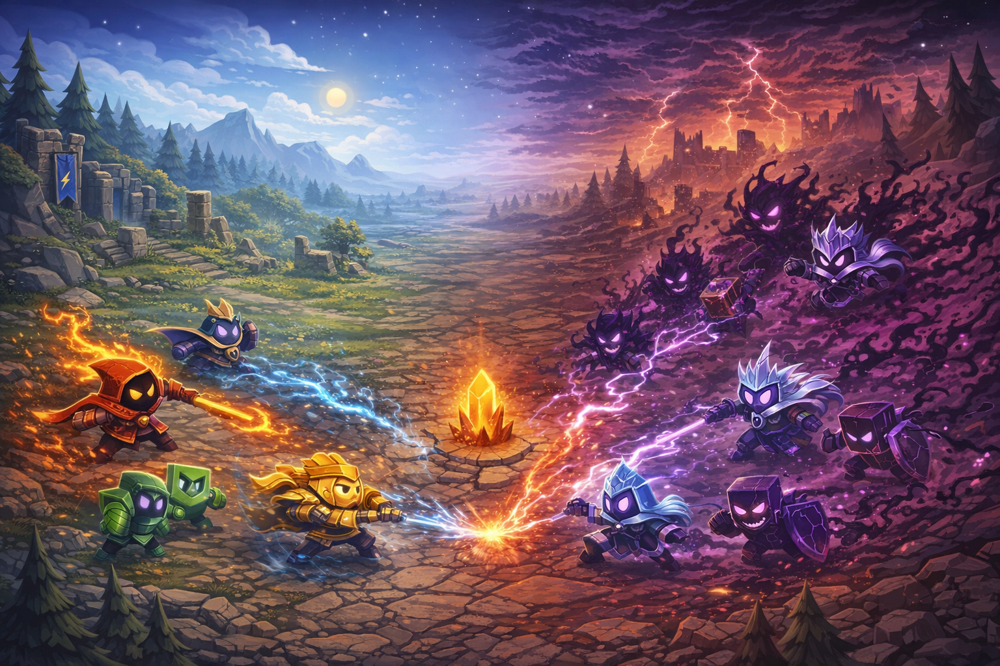

# Shape Strikers ⚔️

A tactical lane-based auto-battler built with **vanilla HTML, CSS, and JavaScript** — no game engine required.

🎮 **[Play Now](https://bytesower.github.io/ShapeStrikers-no-phaser-/)**



---

## About

Shape Strikers is a rogue-like auto-battler where you buy, place, and upgrade shape-drawn units to fight through waves of enemies. Strategy comes from **element synergies**, **unit positioning**, and **economy management**.

### Features

- **45 unique units** across 4 tiers and 8 elements (40 playable + 5 bosses)
- **Lane-based combat** on a 6×5 grid with automatic pathfinding
- **5 boss fights** with multi-phase mechanics (Waves 5, 10, 15, 20, 25)
- **2 campaign modes** — Normal (15 waves) and Void Campaign (25 waves with hard mode scaling)
- **Element synergy system** — stack elements for stat bonuses
- **10 status effects** — burn, poison, freeze, slow, shield, barrier, weaken, wound, untargetable, blind
- **Advanced mechanics** — evolve, knockback, pull, kill-stacking
- **Shop & economy** — buy, sell, refresh, earn interest, purchase upgrades
- **Seeded wave generator** — different compositions each run
- **CSS particle VFX engine** — element-colored effects, projectiles, shockwaves, screen shake
- **Guided tutorial** with spotlight highlights
- **Unit glossary & guidebook** — learn every unit and mechanic in-game
- **Procedural shape-drawn units** — no sprite assets needed for characters
- **Dark mode** and **mobile layout** support — phone, tablet, portrait and landscape
- **Unlockable grid cosmetics** — Glowing rewards a campaign win; luxury Flamebound requires 10 Fire purchases in a victorious run, and Frostbound requires consecutive Normal/Void victories (either order), each with three living 3-star Ice units

### Elements

| Element | Synergy Bonus |
|---------|--------------|
| 🔥 Fire | +ATK |
| 🧊 Ice | +DEF |
| ⚡ Lightning | +SPD |
| 🌍 Earth | +HP |
| 🩸 Blood | +ATK |
| ☠️ Plague | +ATK |
| ✨ Arcane | +ATK / +SPD (unlockable) |
| 🕳️ Void | +ATK / +HP (unlockable) |

## How to Play

1. **Buy units** from the shop using gold
2. **Place them** on your side of the grid (bottom 2 rows)
3. **Press Fight** — units auto-battle toward the center battle line
4. **Win waves** to earn gold, then spend it on more units and upgrades
5. **Survive 15 waves** (Normal) or **25 waves** (Void Campaign) to win

### Campaign Modes

| Mode | Waves | Bosses | Unlock |
|------|-------|--------|--------|
| **Normal** | 15 | Sun Dragon (W5), Frost Giant (W10), Void Supreme (W15) | Available from start |
| **Void Campaign** | 25 | + Void Leviathan (W20), Void Architect (W25) | Beat Normal mode once |

Void Campaign features **hard mode scaling** — enemy stats increase from waves 16-25 (up to 2× HP, 1.6× ATK). Void units become available to players.

## Running Locally

No build step needed. Just serve the files:

```bash
# Python
python3 -m http.server 8000

# Node
npx serve .
```

Then open `http://localhost:8000` in your browser.

Multiplayer identifiers require Web Crypto in a supported browser. Use HTTPS when hosting, or localhost for development. If secure identifiers are unavailable, new room joins fail with an explanatory message and telemetry recording/upload is disabled without preventing the game from loading.

### Tests

There is no build step or package manifest. Run the tests directly with Node 22 or newer:

```bash
node --test                         # all unit tests under tests/
node scripts/checkDeterminism.js    # battle determinism across 100 seeds
```

### Local dev tools

On `localhost` only, add `?dev=1` to the URL to show a 🛠 Dev Tools panel. It can grant campaign unlocks, unlock achievements, reset progression, raise battle speed, and switch animated grid effects between the Canvas 2D and WebGL renderers. It is inert on the hosted site.

### Private Run History (isolated staging preview)

The feature branch includes native IndexedDB history, private Supabase RPCs, and History/account screens. They are **not enabled on the live site or by an ordinary static server**. The approved session-only preview server injects browser-safe staging settings and the three history scripts only for `?staging=1`; `?dev=1` is optional. Do not put database/SMTP passwords or service-role keys in browser configuration.

- Tracks new Normal/Void and daily/weekly attempts, not multiplayer or historical leaderboard backfill.
- Records the final-wave win immediately; Continue still controls the existing campaign/cosmetic reward timing. Recruitment means successful paid placement, not card previews or survivors.
- Participant identifiers are serialized as text in history; numeric gameplay IDs remain unchanged.
- Preserves one pending snapshot per run with a 32 KiB canonical summary limit, 100 pending records, and 1 MiB serialized pending-queue budget, including reserved ownership, generation, hold, and error metadata so a full guest queue can still bind and report failures. Persisted diagnostics are bounded and label truncation. Failures warn visibly without blocking gameplay or evicting pending records.
- Reload interruption requires an owned-tab exit witness. Unknown/crashed attempts remain Unfinished, not fabricated losses. Offline play requires an already loaded game; this is not save/resume or a PWA.
- Pending records never transfer between accounts. Unassigned records require explicit assignment to the same guest flow, including after that guest links an email without changing UID. Actual UID changes start a new guest flow, stop realtime/room recovery, and reload; existing-account sign-in does not merge histories.
- Runs started while history deletion is in progress remain on the browser for explicit review. Initial connection failures can retry on reconnect or from History, and unsynced upload errors remain visible.
- Held records are excluded from the normal synced-result cache cleanup until explicitly restored or discarded. Offline pending records remain visibly marked even before an account connects.
- All staging/dev runs are test-marked. Show test records to inspect them; ordinary all-account totals exclude tests and incomplete attempts.

Apply the existing base schema to a new, isolated database first, then [supabase_run_history_v1.sql](supabase_run_history_v1.sql), then [supabase_run_history_v1_privacy.sql](supabase_run_history_v1_privacy.sql) (self-service history erasure with server-issued deletion generations, plus a maintainer-only `admin_erase_account`). Older or unknown-generation browser records remain local until the player chooses restore or discard. These migrations are run-once: clear a failed SQL transaction with `ROLLBACK;`, then rerun the corrected migration only if it did not commit. Do not drop tables or blindly rerun committed migrations. Subsequent function repairs require scoped repair SQL.

If the earlier privacy migration is already installed, [supabase_run_history_v1_privacy_repair.sql](supabase_run_history_v1_privacy_repair.sql) replaces only the account-erasure helper so projects without optional multiplayer queue/room tables can delete accounts. Existing production projects do not need the full base schema reapplied or unused multiplayer tables created. See the [staging-only SQL regression](tests/history/accountErasure.sql); production still requires separate approval.

Existing staging installations with the former timestamp cutoff use the run-once [generation repair](supabase_run_history_v1_erasure_generation_repair.sql), with no concurrent history clients and the matching client deployed together. The RPC signature changes; older clients are incompatible. This repair was installed only on staging, not production.

The opt-in [cloud integration tests](tests/history/cloudIntegration.test.js) require `SHAPE_STRIKERS_STAGING_CONFIG` (an external JSON file containing only `url` and `publishableKey`), `SHAPE_STRIKERS_ALLOW_STAGING_WRITES=1`, and `SHAPE_STRIKERS_STAGING_SERVICE_ROLE_KEY` set to the staging project's service-role JWT. The key is used only by the test teardown to delete its tagged disposable accounts; never put it in the JSON file, browser, or repository. Ordinary `node --test` skips these tests unless both the config path and write opt-in are set; if opted in without a valid cleanup key, preflight fails before creating fixtures. No production seeding or configuration changes are authorized.

The maintainer confirmed staging guest linking and existing-account recovery from a separate browser, including controlled reload, recovered history visibility, and separation of the other guest's runs. Incorrect-code errors, continued form/gameplay availability, request rate limiting, and successful retry after cooldown were also verified. Cancel resets the code form without bypassing the sending cooldown; another request succeeded after cooldown. Actual expired-code rejection and fresh-code recovery were verified with a shortened staging expiry; the original setting was then restored and saved.

The privacy migration is applied to staging. The maintainer verified downloading history JSON, deleting account run history in game, and receiving mail through the support forwarding rule. Automated staging checks passed owner-only erasure, stale-upload rejection, saving later runs, and denial of player access to the privileged account-deletion function. A separately authorized privileged deletion test passed with disposable guest accounts, including related-data cleanup, control-account isolation, and rejection of the deleted account by Auth and history upload. Test fixtures were removed. Email ownership confirmation remains a manual runbook step; history-only deletion does not delete the sign-in account.

Production rollout remains gated on reviewed production schema/auth/SMTP configuration and separate frontend rollout approval. Staging real-recipient delivery is verified with Cloudflare Email Sending SMTP: host `smtp.mx.cloudflare.net`, port `465` (implicit TLS; 587/STARTTLS is unsupported), username literally `api_token`, password a Cloudflare API token with Email Sending: Edit, and a sender on the verified sending domain. Never put SMTP tokens in the browser game. Mailtrap Email Sandbox (`sandbox.smtp.mailtrap.io`) remains usable for capture-only testing. Enable the history scripts after Backend and before Game only after those gates pass. Roll back by disabling the frontend, preserving the private schema and pending data.

Production code-bearing sign-in and email-change templates are saved and reload-verified with separate approvals. The maintainer privately entered the SMTP token and saved custom SMTP; enabled status and non-secret settings are reload-verified. Production limits are 30 emails/hour and at least 60 seconds between emails per user. A separately authorized Auth-only production test passed real code delivery, guest linking, recovery to the same disposable account, and authenticated reload, with the maintainer entering the address/codes privately. That production test account was removed with separate cleanup approval. After explicit confirmation that all staging accounts were disposable, all 36 remaining staging test accounts and their 121 history records were removed; Auth/session/history cleanup was verified and schema retained. Opening the staging game again can create a fresh anonymous guest normally. Production history migrations and frontend release remain gated.

## Tech Stack

- **HTML5 / CSS3 / ES6+ JavaScript** — zero dependencies
- **Canvas API** — for unit shape rendering and animated grid effects (optional built-in WebGL renderer, no library)
- **GitHub Pages** — static hosting via Actions workflow

## Privacy

Shape Strikers stores settings, unlocks, and run-related progress in your browser using local storage. If you submit a leaderboard score, the game stores your chosen display name, score, and run summary using anonymous Supabase authentication. No email or password is required.

**Account-backed Run History is currently a staging preview and is not available on the live site.** In that preview, it stores compact private roster/combat summaries in IndexedDB and in the authenticated user's Supabase history. Optional email-code recovery stores the email with Supabase Auth, not in history payloads. Browser cache/offline queues are device-local; local unlocks and cosmetics are not cloud-synced. These are client-reported personal records, not verified rankings. Preview cloud records have no automatic expiry.

When Run History is released, signed-in players will be able to download their cloud history as JSON and permanently delete it from **Account / Recovery → Your data**; deletion will also clear that account's pending/cached copies in the browser, and the server will reject older pending uploads from other devices so deleted runs are not re-created. To request deletion of a whole account (sign-in email and leaderboard scores), email **support@shapestrikers.com** from the linked address; the maintainer verifies ownership by replying to that address and follows [docs/privacy-requests.md](docs/privacy-requests.md). Never send codes, passwords, or tokens, and do not post private details in public issues. Clearing all site storage also removes local unlocks/settings.

## Documentation

- [docs/current-roadmap.md](docs/current-roadmap.md) — active source of truth for current priorities and sequencing
- [docs/privacy-requests.md](docs/privacy-requests.md) — maintainer runbook for data access and deletion requests
- [docs/effects-workflow.md](docs/effects-workflow.md) — workflow and implementation conventions for game visuals
- [GAME_DESIGN.md](GAME_DESIGN.md) — Full game design document (rules, stats, formulas, mechanics)
- [PROGRESS.md](PROGRESS.md) — Development progress tracker and shipped phase history
- [AUDIT.md](AUDIT.md) — Codebase audit and architecture assessment

## License

MIT

---

*Made by [ByteSower](https://github.com/ByteSower)*
